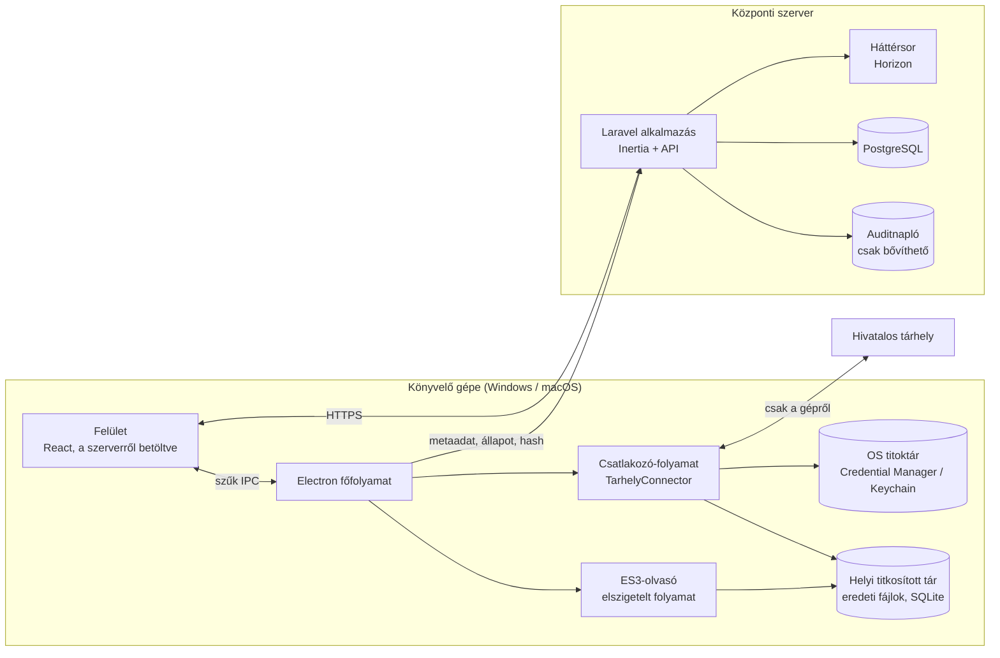
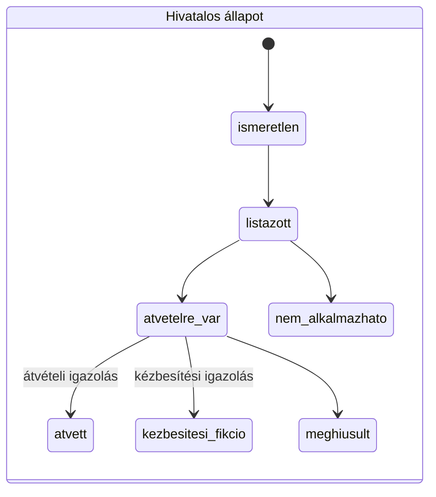
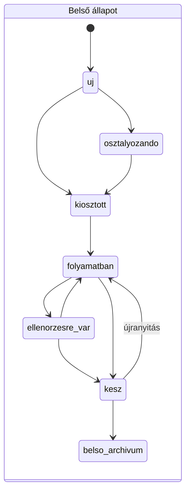
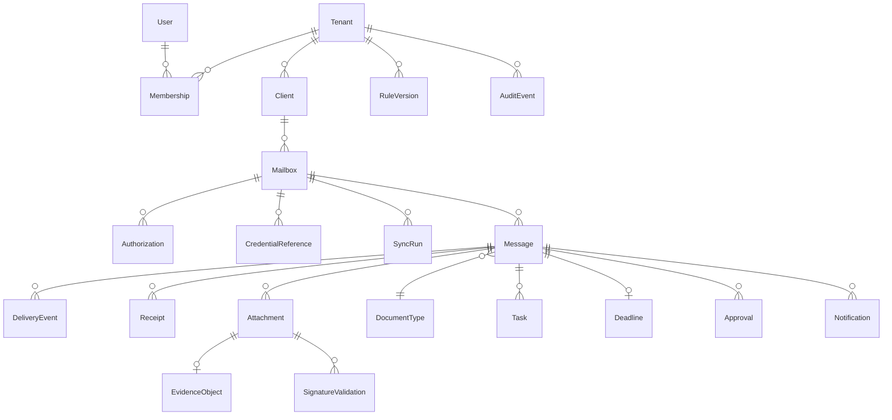

# Architektúra

Állapot: tervezet a fejlesztés indításához. A döntések indoklása az [adr/](adr/) mappában, a bizonyítékok a [research/](../research/) mappában.

## Egy mondatban

Központi Laravel-alkalmazás tartja az iroda közös munkáját (ügyfelek, feladatok, szabályok, audit), egy vékony Electron asztali alkalmazás (Windows és macOS) pedig helyben futtatja a tárhely-csatlakozót, és helyben őrzi a belépési titkokat.

## Komponensek



### Mi hol fut

| Feladat | Hol | Miért |
|---|---|---|
| Belépés a tárhelyre, listázás, letöltés | Asztali csatlakozó-folyamat | A jelszó és a TOTP-kulcs nem hagyja el a gépet |
| Titkok tárolása | OS titoktár | Az OS felhasználói fiókjához kötött védelem |
| Eredeti fájlok (ES3, PDF) | Helyi titkosított tár – a központi tárolás nyitott döntés | Lásd [ADR-003](adr/ADR-003-dokumentumtar.md) |
| ES3 kibontása, aláírás-ellenőrzés | Elszigetelt helyi folyamat | Nem megbízható bemenet; lásd [ADR-005](adr/ADR-005-es3-hitelesseg.md) |
| Ügyfelek, jogosultságok, feladatok, szabályok | Központi szerver | Több munkatárs közös munkája |
| Jóváhagyások, audit | Központi szerver | Nem lehet a kliensen megkerülni |
| Értesítések, emlékeztetők | Központi háttérsor | Akkor is menjen, ha senki gépe nincs bekapcsolva |

### Következmény, amit ki kell mondani

A szinkron csak akkor fut, ha legalább egy jogosult munkatárs asztali alkalmazása fut és be van jelentkezve az adott tárhelyre. Éjszakai, felügyelet nélküli szinkron ebben a felépítésben nincs. Ez tudatos csere a biztonságért; ha üzletileg nem vállalható, az [ADR-001](adr/ADR-001-platform.md) alternatívái közül kell választani, és a titokkezelést újra kell értékelni.

## A csatlakozó szerződése

Minden tárhely-hozzáférés ezen az egy felületen megy át. A felület többi része nem tudja, mi van mögötte.

```ts
type LegalEffect = 'none' | 'possible' | 'certain' | 'unknown';

interface OperationPolicy {
  mayAffectDelivery: LegalEffect;   // kiválthat-e átvételt
  requiresApproval: boolean;        // 'unknown' és 'possible' esetén mindig true
  autoRunnable: boolean;            // futhat-e háttérben, emberi kérés nélkül
  retryable: boolean;               // újrapróbálható-e automatikusan
  evidence: string;                 // hivatkozás a research/ megfelelő sorára
}

interface OperationContext {
  tenantId: string;
  mailboxId: string;
  actorId: string;                  // ember vagy 'system'
  idempotencyKey: string;
  approvalId?: string;              // kötelező, ha requiresApproval
  signal: AbortSignal;
}

interface TarhelyConnector {
  capabilities(): Promise<Record<OperationName, OperationPolicy & { supported: boolean }>>;
  connect(ctx: OperationContext): Promise<ConnectionState>;
  listAccounts(ctx: OperationContext): Promise<MailboxRef[]>;
  listMessages(ctx: OperationContext, since?: string): Promise<MessageRef[]>;
  getMetadata(ctx: OperationContext, messageId: string): Promise<MessageMetadata>;
  getReceipt(ctx: OperationContext, messageId: string): Promise<Receipt | null>;
  download(ctx: OperationContext, messageId: string): Promise<DownloadResult>;
  moveToDurable(ctx: OperationContext, messageId: string): Promise<DurableResult>;
  health(): Promise<HealthState>;
  disconnect(ctx: OperationContext): Promise<void>;
}
```

Kikényszerített szabályok (a csatlakozó előtt álló őrfüggvényben, nem a hívók jóindulatán múlik):

1. Ha `mayAffectDelivery` nem `'none'`, a hívás `approvalId` nélkül elutasítva.
2. Ha `autoRunnable` hamis, a hívás csak emberi `actorId`-vel fogadható el; ütemezőből és újrapróbálkozásból nem.
3. Offline állapotban joghatású művelet nem kerül sorba későbbi végrehajtásra.
4. Minden hívás előtt és után audit esemény íródik; a hívás az audit sikeres írása nélkül nem indul.
5. Titok, munkamenet-süti és TOTP-kulcs nem kerül naplóba, hibaüzenetbe, keresőindexbe vagy nyelvi modell bemenetébe.

A műveletek kezdő besorolását az [ADR-004](adr/ADR-004-joghatas-kapuk.md) tartalmazza.

## Két független állapotgép





- A hivatalos állapotot kizárólag `DeliveryEvent` írhatja, amelyhez `EvidenceObject` tartozik. Felhasználói kattintás közvetlenül soha.
- A belső állapot, az olvasottság, a prioritás és a felelős külön mezők.
- Egyetlen kereszthatás van: `atvetelre_var` hivatalos állapotú irat belső állapota nem lehet `kesz`.

## Adatmodell



Kulcsszabályok:

| Szabály | Részlet |
|---|---|
| Egyedi kulcs | `forrás + tárhely + forrásüzenet-azonosító`. Tartalom-hash csak másodlagos duplikációjelző. |
| Idempotens szinkron | Ugyanaz a küldemény újra megérkezve frissít, nem hoz létre új ügyiratot, feladatot vagy értesítést. |
| Tenant-határ | Minden tábla `tenant_id`-vel; globális scope a modellen és külön ellenőrzés a háttérfeladatokban, exportban, keresésben. |
| Ügyfélszintű hozzáférés | A könyvelő csak a ráosztott ügyfeleket látja; a szabály a lekérdezés szintjén érvényesül, nem a felületen. |
| `CredentialReference` | Csak hivatkozás az OS titoktár bejegyzésére; a szerver adatbázisában titok nincs. |
| `Deadline` | `date`, `confidence` (megerősített / becsült / ismeretlen), `source`, `rule`, `confirmed_by`. |
| `AuditEvent` | Csak bővíthető; UTC idő, szereplő, művelet, erőforrás, előző és új állapot, szabályzat-verzió, bizonyíték. Adatbázis-szinten nincs UPDATE és DELETE jog. |
| `DocumentType` | `type_id`, címke, szinonimák, minták, küszöb, forrás, hatályosság, verzió. Az „ismeretlen” elsőrendű típus. |

## Biztonsági határok

| Határ | Védekezés |
|---|---|
| Távoli felület az Electronban | `contextIsolation`, `sandbox`, kikapcsolt Node-integráció, szűk és típusos preload-felület, szigorú CSP, csak a saját origó tölthető be |
| Felület → csatlakozó | A felület csak műveletet kér; titkot, sütit soha nem kap vissza |
| Nem megbízható fájl (ES3, PDF, csatolmány) | Külön folyamat, méret-, elemszám-, mélység- és időkorlát; XXE és külső entitás tiltva; fájlnév-normalizálás |
| Tenantok között | Lekérdezés-szintű szűrés + automatizált IDOR-tesztek minden végpontra |
| Nyelvi modell | Csak külön csatornán, ügyfélszintű engedéllyel; titok és munkamenet soha; a gépi címke a felületen jelölve |

## Megfigyelhetőség

Csatlakozó állapota, utolsó sikeres szinkron tárhelyenként, hibaarány, szinkronkésés, át nem vett sürgős iratok száma és kora, lejárt jóváhagyások, sikertelen hitelességvizsgálatok. Hibakövetés: Sentry (a fejlesztői környezet is ezt használja), titokszűréssel.

## Tesztelés

| Szint | Tartalom |
|---|---|
| Egység | Szabálymotor, jogosultság, határidő-bizonyosság, állapotgépek, ES3-olvasó |
| Szerződés | Ál-csatlakozó, amely minden képességet és minden hibát elő tud állítani; az őrfüggvény tesztjei ezen futnak |
| Integráció | Anonimizált valódi minták; engedélyezett tesztfiók – **élő tárhelyen joghatású teszt csak külön írásos engedéllyel** |
| Végponttól végpontig | Csatlakoztatás, 100+ ügyfél, keresés, ES3, offline, megszakadt munkamenet |
| Biztonság | IDOR, tenant-áttörés, XXE, tömörítési bomba, útvonal-bejárás, titokszivárgás a naplóban |
| Jogi regresszió | A műveleti besorolás bármely változása felülvizsgálói jóváhagyáshoz kötött, a CI ellenőrzi |
